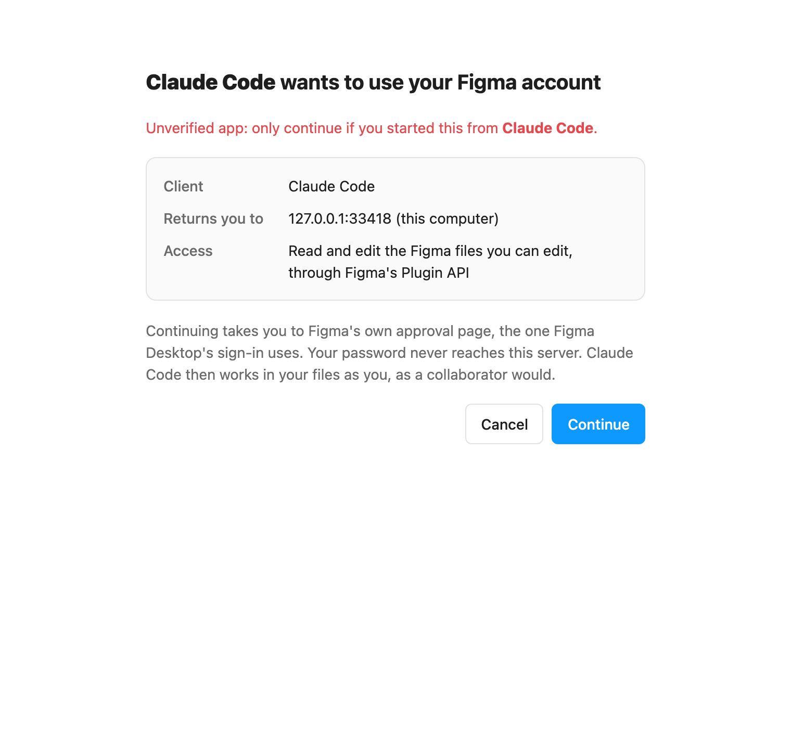
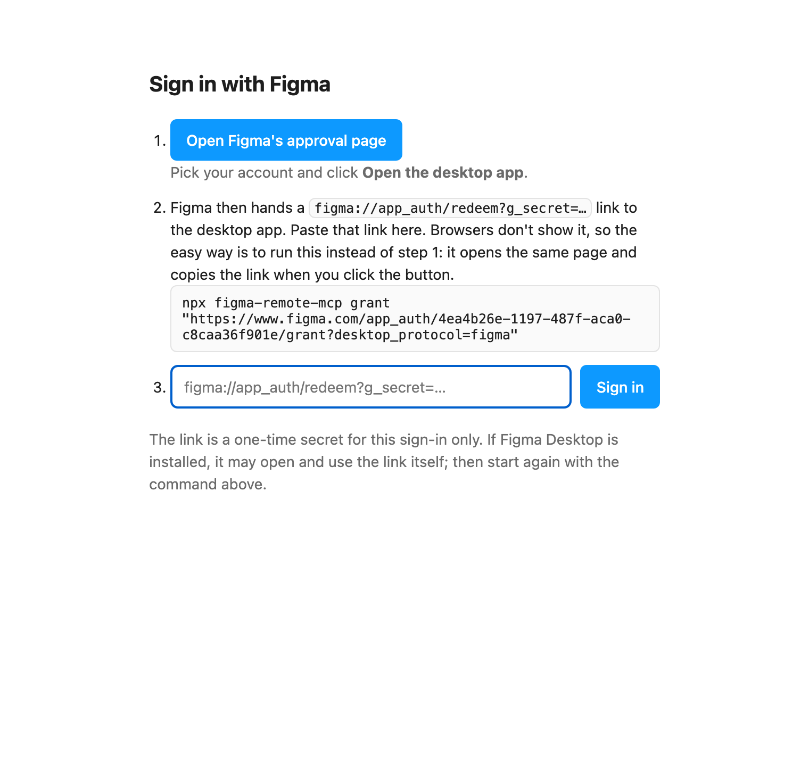

# figma-remote-mcp

**Figma's MCP, without the desktop app, without seat or rate limits.** Read and write Figma designs from Claude Code,
Cursor, Codex or any MCP client, on your machine or hosted for a team.

figma-remote-mcp runs figma.com's own editor in headless Chromium, standing in for Figma Desktop's shell, and serves
**71 tools through Figma's Plugin API**: read a design (`get_design_context`, `get_node`, `search_nodes`,
`get_variable_defs`, `get_styles`, `get_screenshot`, …), and write one (`create_frame`, `create_text`, `set_fills`,
`set_auto_layout`, variables, styles, components, prototypes, pages, …).

The Plugin API runs in your editor, so it needs no Dev Mode seat and no MCP quota. That's
[figma-mcp-rust](https://github.com/alvinindra/figma-mcp-rust)'s approach, whose MIT plugin this vendors (see Credits).
figma-mcp-rust needs Figma Desktop open with the plugin running; here the plugin runs inside the headless editor, and
there is nothing to install in Figma.

Figma Desktop's own Dev Mode MCP tools (React + Tailwind code generation) are there too with `--dev-mode`, for accounts
whose seat includes them.


_Made through the MCP tools, `create_frame` and `create_text`, on an account without a Dev Mode seat, exported with
`get_screenshot`._

## Run it locally

```bash
npx figma-remote-mcp login      # one-time: sign in to Figma in a browser window
npx figma-remote-mcp doctor     # browser ✓ sign-in ✓ tools ✓
claude mcp add figma -- npx -y figma-remote-mcp mcp
```

- **Cursor**: `~/.cursor/mcp.json`: `{ "mcpServers": { "figma": { "command": "npx", "args": ["-y", "figma-remote-mcp", "mcp"] } } }`
- **Codex**: `~/.codex/config.toml`: `[mcp_servers.figma]`, `command = "npx"`, `args = ["-y", "figma-remote-mcp", "mcp"]`
- **VS Code**: `.vscode/mcp.json`: `{ "servers": { "figma": { "type": "stdio", "command": "npx", "args": ["-y", "figma-remote-mcp", "mcp"] } } }`

## Connect to a hosted server

```bash
claude mcp add --transport http figma https://<your-server>/mcp
```

 

Signing in is Figma Desktop's own sign-in:

1. Your client opens the server's consent page → **Continue**.
2. **Open Figma's approval page**, pick your account, click **Open the desktop app**.
3. Figma hands a one-time `figma://app_auth/redeem?g_secret=…` link to the desktop app. Paste it into the sign-in page.
   Browsers don't show that link, so the easy way is `npx figma-remote-mcp grant "<approval page URL>"`: it opens the
   same page and copies the link when you click the button.
4. Done: your client gets a token and refreshes it itself.

Your Figma password never reaches the server; the pasted link is a one-time secret for that sign-in.

## Host it

Any Docker host (one image; several Figma accounts per server):

```bash
docker build -t figma-remote-mcp .
docker run -d --restart=always -p 127.0.0.1:8080:8080 \
  -e SEAL_KEY="$(openssl rand -base64 32)" -e PUBLIC_URL=https://figma.example.com \
  figma-remote-mcp
```

Put a TLS reverse proxy or tunnel in front at `PUBLIC_URL`.

| Variable | Meaning |
| --- | --- |
| `SEAL_KEY` | Required. 32 random bytes, base64. Everything the server hands out is sealed with it; changing it signs everyone out. |
| `PUBLIC_URL` | The origin clients see (`https://figma.example.com`). |
| `PORT`, `HOST` | Listen address (default `0.0.0.0:8080`). |
| `MAX_ACCOUNTS` | Figma accounts with a live editor at once (default 6). |
| `MAX_FILES` | Open files per account (default 2). Each open file takes about 2 GB of RAM (measured 1.7–2.5 GB), so size the host for `MAX_ACCOUNTS × MAX_FILES × 2 GB`, or lower them. |
| `FIGMA_DEV_MODE_TOOLS` | `1` also lists Figma's Dev Mode tools (`dev_mode_*`). |
| `STATIC_CACHE_DIR` | Disk cache for figma.com's immutable editor assets (~130 MB), shared by every account. |
| `FIGMA_REMOTE_LOG` | `debug`, `info`, `warn`, `error` or `silent`. |

What the server keeps:

- **No database.** Figma session cookies travel inside the client's tokens, sealed with AES-256-GCM. Access tokens last
  1 hour and refresh tokens 30 days. Every refresh asks Figma whether you're still signed in and folds in Figma's cookie
  renewals, so signing out in Figma ends access within the hour.
- **In memory only:**
  - one browser context per active Figma account, closed after 10 idle minutes (or, past `MAX_ACCOUNTS`, the least
    recently used one, once its running calls finish). Idle file pages are frozen, so they cost little CPU;
  - image assets from tool results, for an hour, behind unguessable URLs.

## Commands

| Command | What it does |
| --- | --- |
| `mcp` _(default)_ | stdio MCP server on the session `login` saved. |
| `login` / `logout` | Sign in once in a browser window; delete the saved session. |
| `doctor [--file <key\|url>]` | Check the browser, the sign-in, the tools (and one call on a file). |
| `serve` | The hosted HTTP server (above). |
| `grant <approval URL>` | Approve a hosted server's sign-in from this machine. |

`--dev-mode` (hosted: `FIGMA_DEV_MODE_TOOLS=1`) also lists Figma Desktop's own Dev Mode tools as `dev_mode_*`
(`dev_mode_get_design_context` generates React + Tailwind). These need a Dev or Full seat, and Figma's MCP rate limits
apply to them.

## Using the tools

- **Name the file.** There is no open tab or selection, so every tool takes a `fileKey`: the key from
  `figma.com/design/<fileKey>/…`, a branch key, or the whole URL. A URL's `node-id` is used when `nodeId` is left out,
  and a call without `fileKey` uses the previous call's file.
- **Expect a wait on the first call.** The first call on a file waits for Figma to load the whole document (often
  10–30 s; Figma allows plugins only then). Later calls take milliseconds.
- **Plugins run only in files you can edit.** Figma runs plugins in files this account can edit (your drafts and team
  files, any plan). For a view-only file, Figma says no; duplicate it to your drafts.
- **Writes are live edits,** like a collaborator's: they show up for everyone in the file, and Figma's version history
  can undo them. The server waits for Figma to confirm each file is saved before it rests or closes the editor.
- **Screenshots** come back as image content. With `--dev-mode`, asset links in `dev_mode_get_design_context` point at
  this server and last an hour.

## Speed and resilience

Measured on an 88-page design system file (`node scripts/bench.mjs <file>`, Apple M-series, local mode):

| | p50 | p95 |
| --- | --- | --- |
| `initialize` / `tools/list` (static catalog, no editor) | 149 ms / 5 ms | |
| warm call over MCP stdio (`get_pages`) | 8 ms | 17 ms |
| `get_metadata` / `get_design_context` (depth 2) / `get_node` | 6 / 26 / 36 ms | 8 / 29 / 318 ms |
| `get_variable_defs` | 347 ms | 366 ms |
| `get_screenshot` (large frame, scale 1) | 1.4 s | 2.4 s |
| first call on a file the warm-up already opened | 17 ms | |
| first call on a cold file: editor 5 s + Figma loading the whole document | 7 s (small) to 22 s (88 pages) | |

- **Warm-up:** on `initialize`, the server opens your most recently opened Figma file in the background (turn it off with
  `FIGMA_WARM=0`). The first call usually finds it warm.
- **Files stay open:** idle files stay open but frozen, so another call on them is instant without burning CPU.
  - **Local:** the last 3 files stay open.
  - **Hosted:** 2 files per account (`MAX_FILES`), for 30 idle minutes (`IDLE_MINUTES`).
- **The cold floor is Figma's own load,** the same wait as opening the file in the app. Figma allows plugins only
  once the document has loaded; starting earlier was tried, and Figma drops the plugin.
- **Recovery** (exercised by `node scripts/chaos.mjs <file>`):
  - A crashed page reopens on the next call.
  - A reloaded editor (Figma ships a release) gets its plugin restarted.
  - A Chrome process that died is relaunched.
  - A read that a reload interrupts runs again by itself. A write is never sent twice: you're told to check the file.
- **Long-lived editors:** pages are reloaded between calls after 4 hours, before Figma's editor grows too large.
- **Never cut short:** a plugin start Figma drops is retried. An evicted or idle account closes only after its running
  calls finish, and only once Figma confirms its edits are saved.

## Troubleshooting

- **"Figma doesn't run plugins in this file"**: the file is view-only for this account. Ask for edit access, or
  duplicate it to your drafts.
- **`dev_mode_*`: "…paid Figma seat includes Dev Mode access…"** is Figma's seat check (the desktop app answers the
  same). "The MCP server is not enabled for this user" means turning on Dev Mode's MCP server once in Figma's
  preferences.
- **The first call on a file is slow**: Figma loads the whole document before it allows plugins (often 10–30 s).
  Later calls take milliseconds.
- **"The profile … is in use"**: one process per browser profile. Quit the other `figma-remote-mcp` (or pass `--profile`).

## How it works

```
MCP client ──stdio or HTTP+OAuth──► figma-remote-mcp
                                       │ page.evaluate
                                       ▼
                       headless Chromium, one context per Figma account
                         figma.com/design/<key>  ◄── window.__figmaDesktop stand-in (installed before Figma's code)
                           ├─ local plugin 1 (the tools plugin), served as Figma Desktop serves development plugins
                           │    {type, nodeIds, params} → figma.ui.onmessage → Plugin API → figma.ui.postMessage
                           └─ (--dev-mode) Figma's desktop MCP handler: sendMCPQuery → sendMCPResult
```

- figma.com checks for `window.__figmaDesktop` once, as its bundle loads. With it present, the page asks the "desktop"
  for its development plugins (`getLocalManifestFileExtensionIdsToCachedMetadataMap`, `getLocalFileExtensionManifest`,
  `getLocalFileExtensionSource`). The stand-in serves the tools plugin and starts it the way Plugins › Development ›
  <name> does.
- Requests go straight to the plugin's main thread (`figma.ui.onmessage`), and its answers are caught on their way to
  its UI frame, so no WebSocket is involved.
- With `--dev-mode`, the page also registers the desktop message handler that runs Figma Desktop's local MCP tools,
  exactly as in the app.
- The stand-in (`src/shim.js`) answers only what the shell answers: an empty font list, "MCP server running" and so
  on. It passes tool queries to the page and returns the page's replies.
- `tools/list`, prompts and resources are the page's `internal_get_tools`, `internal_get_prompts_list`,
  `internal_get_resources_list`, `internal_get_resource` and `internal_get_prompt` queries, the same ones Figma Desktop's
  server sends.
- Figma's CDN refuses HeadlessChrome's user agent, so the browser presents a desktop Chrome one. SwiftShader gives the
  editor WebGL without a GPU.

Details and evidence: [docs/how-it-works.md](docs/how-it-works.md).

## What it does not do

- **It does not bypass Figma's entitlements.** The plugin tools use the Plugin API that every Figma plan includes,
  with the editor's own permission checks (edit access, "can run plugins"). The `dev_mode_*` tools keep Figma's seat,
  org-admin and rate-limit checks unchanged, so you get the desktop app's answers, including "paid Figma seat includes
  Dev Mode access" when it doesn't.
- **It depends on figma.com's internals** (the desktop bridge and its message names). If Figma changes them,
  `doctor` says so.
- **Figma's analytics see a desktop app:** the page believes it is Figma Desktop 126.11.11, running a development
  plugin.

## Development

```bash
git clone https://github.com/vcashwin/figma-remote-mcp && cd figma-remote-mcp
npm install
npm test && npm run typecheck
node src/cli.js login && node src/cli.js doctor
```

## Credits

The tools plugin and its tool catalog and prompts (`src/plugin/`) are
[figma-mcp-rust](https://github.com/alvinindra/figma-mcp-rust) v0.2.2 by alvinindra, a port of
[figma-mcp-go](https://github.com/vkhanhqui/figma-mcp-go) by vkhanhqui, both MIT (`src/plugin/LICENSE`).

> Community project, not affiliated with or endorsed by Figma. Use it with your own Figma account, under Figma's terms.
> MIT © vcashwin
